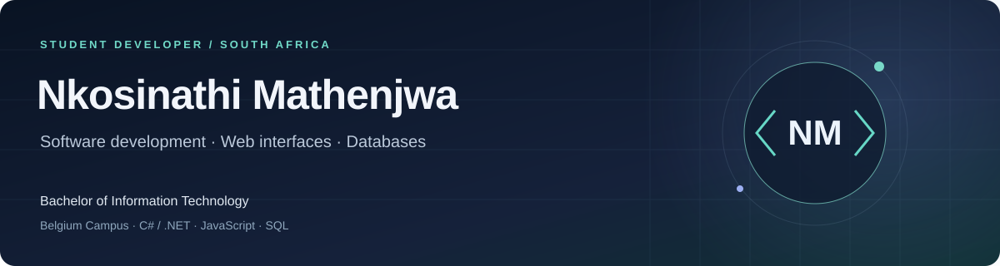

  <strong>Building practical software while studying for a Bachelor of Information Technology at Belgium Campus.</strong> 
  Open to internships and student development opportunities.

  <a href="https://www.linkedin.com/in/nkosinathi-mathenjwa-b08764361/">LinkedIn</a>
  &nbsp; · &nbsp;
  <a href="mailto:mathenjwankosinathi006@gmail.com">Email</a>
  &nbsp; · &nbsp;
  <a href="https://nkosinathi-bit.github.io/media-kit/">Creator website</a>

## Selected work

Four projects that show different parts of my development journey. See the browser captures and recorded console output below; each project README includes a larger preview, setup instructions and current scope.

<table>
<tr>
<td width="50%" valign="top">
<h3><a href="https://github.com/Nkosinathi-bit/SpaceStationProject">01 / Space Station Simulator</a></h3>

A C# console simulation with module inheritance, interface contracts, background monitoring, custom events and file logging.

<code>C#</code> <code>.NET Framework</code> <code>OOP</code> <code>Events</code>

<a href="https://github.com/Nkosinathi-bit/SpaceStationProject">Explore the code →</a> Academic project · PRG 271

</td>
<td width="50%" valign="top">
<h3><a href="https://github.com/Nkosinathi-bit/BugTracker">02 / BugTracker</a></h3>

A browser application for creating, updating, assigning and filtering issues, with local persistence and a searchable dashboard.

<code>JavaScript</code> <code>HTML / CSS</code> <code>localStorage</code>

<a href="https://github.com/Nkosinathi-bit/BugTracker">Explore the code →</a> Learning project · Browser-only application

</td>
</tr>
<tr>
<td width="50%" valign="top">
<h3><a href="https://github.com/Nkosinathi-bit/ExamQualifier">03 / Exam Qualification Calculator</a></h3>

A containerised C# application with weighted calculations, input validation, session results and automated container checks.

<code>C#</code> <code>.NET 10</code> <code>Docker</code> <code>GitHub Actions</code>

<a href="https://github.com/Nkosinathi-bit/ExamQualifier">Explore the code →</a> Coursework · Cloud Native Programming

</td>
<td width="50%" valign="top">
<h3><a href="https://github.com/Nkosinathi-bit/media-kit">04 / JAY / NATHI Creator Website</a></h3>

A deployed personal website with responsive layouts, mobile navigation, animated counters and visual portfolio sections.

<code>HTML / CSS</code> <code>JavaScript</code> <code>GitHub Pages</code>

<a href="https://nkosinathi-bit.github.io/media-kit/">View website →</a> · <a href="https://github.com/Nkosinathi-bit/media-kit">View code →</a> Personal project · Static frontend

</td>
</tr>
</table>

## What I work with

| Area | Technologies and concepts practised |
| --- | --- |
| Software | C#, .NET, object-oriented programming, events, exceptions and console applications |
| Web | HTML, CSS, JavaScript, responsive layouts, browser storage and DOM interaction |
| Data | SQL, T-SQL, relational database design and Microsoft Access |
| Development tools | Docker, GitHub and GitHub Actions |

## More coursework and projects

<strong>Explore the rest of my learning portfolio</strong>

| Repository | Context |
| --- | --- |
| [Into The Mind](https://github.com/Nkosinathi-bit/into-the-mind-website) | Academic HTML/CSS wellbeing website with a calm editorial design and desktop/mobile previews |
| [FIFA World Cup Database](https://github.com/Nkosinathi-bit/FifaWC) | Academic group project demonstrating T-SQL, relational design, validation and SQL Server checks |
| [Milly's Chocolate Factory](https://github.com/Nkosinathi-bit/millys-chocolate-factory-database) | Database Development coursework in Microsoft Access |
| [Docker C# Lab](https://github.com/Nkosinathi-bit/Docker-CSharp-Lab) | Introductory C# and containerisation exercise |
| [CloudNativeApplication](https://github.com/Nkosinathi-bit/CloudNativeApplication) | Earlier coursework copy of the exam-calculator assignment |
| [Porgy and Bess](https://github.com/Nkosinathi-bit/porgyandbess) | Educational web presentation with stage effects and interactive visual elements |
| [Umembeso](https://github.com/Nkosinathi-bit/umembeso) | Personal event invitation website |
| [Project workspace](https://github.com/Nkosinathi-bit/project_temp) | Learning scaffold; application source has not yet been added |

## Beyond the code

My background includes student leadership, choral performance and collaborative project documentation. As Documentation Lead for the Campus Voice student project, I organise team contributions and help communicate technical work clearly.

I’m looking for opportunities to contribute to a team, learn from experienced developers and build on the work shown here.

